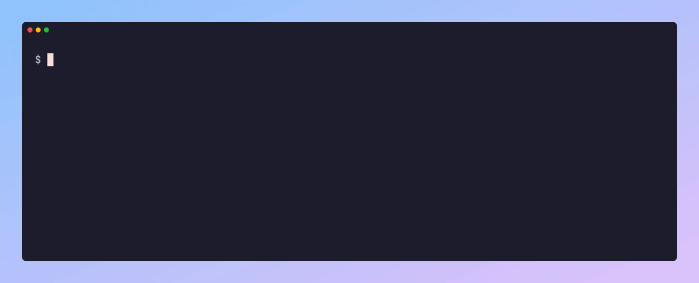

<div align="center">

# Leash

### Your coding agent runs as you. Leash decides what it gets to touch.

[](https://github.com/snitilf/Leash/actions/workflows/ci.yml)
[](#license)

[How it works](#how-it-works) · [Quick start](#quick-start) · [Docs](#documentation)

</div>

Leash is a Linux command-line tool, written in Rust, that wraps an AI coding agent and supervises it at the syscall layer.

An agent runs with your permissions.
It can read `~/.ssh`, run `curl`, and connect to any host.
The only record of what it did is its own summary.

Leash puts the kernel in the loop.
Every file open, program launch, and network connection in the agent's process tree stops and waits while Leash checks it against your policy.
Leash allows it, denies it, or asks you in the terminal.
Every decision lands in an append-only trace, so you read what the agent did, not what it says it did.

With `--snapshots`, Leash also takes a snapshot of the workspace at each quiet moment, a pause in the agent's file writes.
It freezes the agent's whole process tree first.
Each snapshot is a numbered step.
`leash rewind` puts the workspace back to any step.

It works with any agent, because it never talks to the agent.
No SDK, no plugin, nothing the agent can argue with.



## Under the hood

- Interception: a seccomp filter with user notification pauses each mediated syscall and hands it to a single-threaded decision loop (`src/supervisor/run.rs`).
- No path races on allowed opens: in enforce mode, Leash never lets the kernel re-read a path that the agent can swap.
  A confined helper process, the broker, resolves the path with `openat2` beneath a root directory handle.
  The broker returns the file descriptor itself (`src/supervisor/broker.rs`, [ADR-0020](docs/adr/0020-confined-realizer-and-socket-duplication.md)).
- Kernel backstop: in enforce mode, Landlock rules from the same policy refuse filesystem access that the seccomp layer never saw (`src/sandbox/landlock.rs`, [ADR-0003](docs/adr/0003-defense-in-depth-seccomp-and-landlock.md)).
- Fail closed: a supervisor error, an unreadable argument, a failed trace write, or an unanswered prompt all resolve to deny.
- Policy: TOML rules over paths, binaries, and hosts.
  The first match wins.
  Leash validates the whole policy before the agent starts (`src/policy/`).
- Trace: JSONL, synced before the agent starts.
  Leash rebuilds the report from the trace alone (`src/recorder.rs`).
- Snapshots: with `--snapshots`, a cgroup v2 freezer barrier stops the whole process tree before each snapshot.
  Each step is a consistent view of the workspace.
  Files go into a content-addressed store, where each file is stored under its hash.
  Leash writes a chain head, one digest over all steps, to the trace and prints it at run end (`src/supervisor/barrier.rs`, [ADR-0024](docs/adr/0024-enforce-mode-snapshots-without-a-custodian.md)).
- Cost: about 31 to 34 microseconds added per paused file syscall at the median (p50), on a 2 vCPU Ubuntu 24.04 VM ([measurement 0001](docs/measurements/0001-m1-overhead.md)).
- Freeze cost: on a 4 vCPU codespace, each mid-run snapshot froze the agent for a median of 28.0 ms on a workspace of 276 entries.
  The median was 28.3 ms on a workspace of 452 entries.
  The worst case was 99.3 ms in 24 pauses ([measurement 0004](docs/measurements/0004-capture-pause.md)).
  The pause grows with the number of files.
  The measurement does not cover workspaces of tens of thousands of entries.
- Tests: 800+, including an escape suite that swaps symlinks mid-decision, opens through `/proc` magic links, and writes outside the Landlock rules.
  CI runs fmt, clippy with warnings as errors, the full suite on Ubuntu 24.04, a minimum-supported-Rust-version check, and `cargo audit`.

## How it works

1. `leash run -- <agent>` checks the kernel, loads the policy, and creates a run directory before the agent starts.
2. The agent starts under the seccomp filter.
   Every child it spawns inherits the filter.
   The agent cannot drop the filter.
3. The kernel pauses each file open, exec, `connect`, `bind`, `sendto`, and cross-process access, and passes it to Leash.
4. Leash reads the arguments out of the agent's memory, resolves the path or address, and matches the policy.
5. If the policy says ask, Leash names the exact action and the matched rule in the terminal.
   An ask denies after 60 seconds by default.
6. Leash writes the decision to `trace.jsonl` before it answers the syscall.
   When the agent exits, Leash writes `report.txt`.
7. With `--snapshots`, Leash also takes a snapshot of the workspace before the agent starts, at each quiet moment, and when the agent exits.
   `leash diff` compares steps, and `leash rewind` restores one.

With no policy file, Leash runs in record-only mode: it allows and records everything.

## Status

| Part | State |
| --- | --- |
| Record | Working and tested. |
| Enforce | Working and tested. |
| Run history | `leash runs` lists recorded runs with their mode, command, and exit. Pruning is not available yet. |
| Rewind | Working and tested: `leash run --snapshots`, `leash diff`, and `leash rewind`. See [Quick start](#quick-start). |

## Quick start

You need a Rust toolchain to build, and Linux 5.19 or later on x86-64 to run.
The dev container in `.devcontainer/` has the capabilities seccomp and Landlock need.
A GitHub codespace uses it.

```sh
cargo build --release
export PATH="$PWD/target/release:$PATH"
leash --help
```

With [`examples/policy.toml`](examples/policy.toml), Leash denies reads under `~/.ssh` and asks before it writes `.env`:

```
$ leash run --policy examples/policy.toml -- sh -c 'cat ~/.ssh/id_demo'
leash: enforce run
cat: /home/vscode/.ssh/id_demo: Permission denied
leash: run 20261128T032446Z-wluxs5 recorded; report: /home/vscode/.local/state/leash/runs/20261128T032446Z-wluxs5/report.txt

$ leash run --policy examples/policy.toml -- sh -c 'echo API_KEY=demo > .env; cat .env'
leash: enforce run
leash: the agent asks for:
  write /tmp/ws/.env (rule fs.3)
  create /tmp/ws/.env (rule fs.3)
allow? [y/N] (denies in 60s): y
API_KEY=demo
leash: run 20261128T032446Z-3hhuhv recorded; report: /home/vscode/.local/state/leash/runs/20261128T032446Z-3hhuhv/report.txt
```

The approved write is one event in `trace.jsonl` (pretty-printed here):

```json
{
  "seq": 4,
  "ts": 1795477425911,
  "type": "syscall",
  "pid": 4705,
  "syscall": "openat",
  "fact": {
    "family": "fs",
    "path": "/tmp/ws/.env",
    "access": ["write", "create"]
  },
  "decision": "ask",
  "ask_resolution": "approved",
  "matched_rule": "fs.3"
}
```

To undo a run, add `--snapshots`.
This needs a delegated cgroup v2.
In a codespace, create one and move your shell into it:

```sh
sudo mkdir /sys/fs/cgroup/leash && sudo chown -R "$USER" /sys/fs/cgroup/leash
echo $$ | sudo tee /sys/fs/cgroup/leash/cgroup.procs
```

In a workspace with `src/main.rs` and `notes.txt`, this agent edits one file, adds one, and deletes one:

```
$ leash run --snapshots --policy examples/policy.toml -- sh -c 'echo "// wip" >> src/main.rs; echo done > todo.txt; sleep 1.5; rm notes.txt'
leash: enforce run
leash: step 0 snapshot 6f1b72fe5e97...
leash: step 1 snapshot b884f3d235fc...
leash: step 2 snapshot 0f37ea00f4cf...
leash: snapshot chain head daf96b0cd91d...
leash: run 20261128T031903Z-q4me2g recorded; report: /tmp/st/leash/runs/20261128T031903Z-q4me2g/report.txt
leash: to undo this run: leash rewind 20261128T031903Z-q4me2g --expect daf96b0cd91d... --workspace /tmp/ws --state-dir /tmp/st/leash

$ leash diff 20261128T031903Z-q4me2g:0 20261128T031903Z-q4me2g
D  notes.txt
M  src/main.rs
A  todo.txt
1 added, 1 removed, 1 modified
```

To put the workspace back to step 0, run the printed `leash rewind` command.
To go to a later step, add `--step N`.
Rewind first takes a safety snapshot of the current workspace.
It prints the command that undoes the rewind:

```
$ leash rewind 20261128T031903Z-q4me2g --expect daf96b0cd91d... --workspace /tmp/ws --state-dir /tmp/st/leash
chain head: daf96b0cd91d...
step 0 digest: 6f1b72fe5e97...
safety snapshot: /tmp/st/leash/runs/20261128T031903Z-q4me2g/rewind/undo-1 (undo 1)
safety snapshot digest: e5fff7956111...
to undo this rewind: leash rewind 20261128T031903Z-q4me2g --undo 1 --expect e5fff7956111... --workspace /tmp/ws --state-dir /tmp/st/leash
1 removed, 0 directories created, 2 files written, 0 hard links, 0 symlinks, 0 metadata fixes
  write notes.txt
  write src/main.rs
  remove todo.txt
rewound the workspace to step 0: 1 removed, 0 directories created, 2 files written, 0 hard links, 0 symlinks, 1 metadata fixes
rewind reverses filesystem effects only; anything the agent sent off this machine is not undone
```

This page cuts each 64-digit digest to 12 characters and `...`, and sets `XDG_STATE_HOME=/tmp/st` to keep the paths short.
The real output prints all 64 digits.
The printed commands paste as they are.
Keep the chain head somewhere the agent cannot write.
The `--expect` flag is the only check against a forged store.

The output above comes from real runs on Ubuntu 24.04 (kernel 6.8).
`--snapshots` needs `--policy`.

## Known limitations

- On kernels without upstream fix `cce436aafc2a`, a badly timed signal can make an allowed side effect run twice ([ADR-0021](docs/adr/0021-accept-wait-killable-recv-post-send-race.md)).
- Landlock can restrict TCP ports but not hosts, so host rules rest on the seccomp layer alone.
- Snapshots need enforce mode, a writable delegated cgroup v2, and Landlock ABI 3 or later.
  Without all three, `--snapshots` refuses before the agent starts.
- Snapshots are stored as your own files.
  Without `--expect`, Leash cannot detect a forged store and trace.
- `leash rewind` reverses filesystem effects only.
  A request the agent already sent over the network stays sent.
- Enforce mode denies Unix-domain socket connects (dbus, `docker.sock`) until the address parser handles them.

The full list, with what bounds each one, is in [docs/design/escapes.md](docs/design/escapes.md).

## Documentation

- [Specification](docs/spec/SPEC.md): numbered requirements, including the security requirements.
- [Design](docs/design/): architecture, the notify loop, syscalls, policy, trace, and the escape inventory.
- [Decision records](docs/adr/): 26 ADRs, from "why Rust" to which kernel races to accept.
- [Measurements](docs/measurements/): overhead, kernel behavior, and capture pause, with the method behind each number.
- [Glossary](docs/CONTEXT.md): the project's vocabulary.

## Working on Leash

| Command | What it does |
| --- | --- |
| `cargo build --release` | Builds `target/release/leash`. |
| `cargo test` | Runs the unit tests everywhere, and the integration and escape tests on Linux. |
| `cargo clippy --all-targets -- -D warnings` | Lints with warnings as errors. |
| `cargo fmt --check` | Checks formatting. |
| `cargo +1.96 check` | Checks the minimum supported Rust version. |
| `cargo bench --bench overhead` | Runs the overhead harness on Linux. CI does not run it. |

## License

Leash is dual-licensed under [MIT](LICENSE-MIT) or [Apache-2.0](LICENSE-APACHE), at your option.
